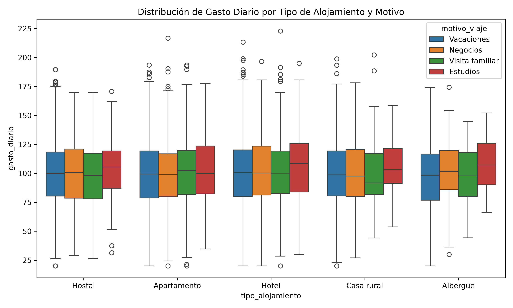

# 📊 EA2. Caso de Estudio: Análisis de los Diferentes Tipos de Datos

# Integrante

Oscar Javier Garcia

Este proyecto implementa un pipeline analítico profesional y modular en Python para procesar, auditar, visualizar y reportar datos de turismo y hospedaje (10,000 registros). Incluye un orquestador principal de procesos, pruebas unitarias automatizadas y un dashboard web interactivo desarrollado con Streamlit.

---

## 📁 Estructura del Proyecto

```text
analisis diferentes tipos datos/
├── datos/
│   └── datos_procesados_turismo.csv      # Dataset principal (10,000 registros)
├── output/
│   ├── graficos/
│   │   ├── vis1_gasto_alojamiento_box.png # Visualización estática (Seaborn)
│   │   └── vis2_tendencia_mensual.html    # Visualización interactiva (Plotly)
│   ├── informes/
│   │   ├── informe_ejecutivo.xlsx         # Resumen ejecutivo y estadísticos
│   │   ├── reporte_errores_datos.xlsx     # Auditoría de calidad de datos
│   │   └── reporte_fallas_sistema.txt     # Log resumido de fallas de ejecución
│   └── logs/
│       └── ejecucion.log                  # Registro de auditoría con timestamps
├── src/
│   ├── __init__.py
│   ├── config.py                          # Configuración centralizada de rutas
│   ├── logger.py                          # Sistema logging central
│   ├── carga.py                           # Carga y validación de esquema
│   ├── visualizaciones.py                 # Generación automática de gráficos
│   ├── reporte.py                         # Exportación a Excel
│   └── reporte_errores.py                 # Auditoría de inconsistencias y fallas
├── tests/
│   ├── __init__.py
│   └── test_pipeline.py                   # Pruebas unitarias (pytest)
├── app.py                                 # Dashboard Web Interactivo (Streamlit)
├── main.py                                # Orquestador principal del pipeline
├── pytest.ini                             # Configuración de rutas para Pytest
├── requirements.txt                       # Librerías y dependencias
└── README.md                              # Documentación general del proyecto
```

---

## 📈 Visualizaciones Generadas

### 1. Distribución del Gasto Diario por Alojamiento y Motivo de Viaje (Seaborn)


> **Descripción:** Muestra la variabilidad y dispersión del gasto diario según el tipo de alojamiento (Hotel, Hostal, Cabaña, Departamento) segmentado por motivo de viaje (Negocios, Vacaciones, Familiar).

### 2. Tendencia Mensual de Gasto e Ingresos Totales (Plotly)
* **Archivo de salida:** `output/graficos/vis2_tendencia_mensual.html`
> **Descripción:** Gráfico temporal interactivo que permite explorar el comportamiento mensual acumulado del gasto total y la frecuencia de viajes. Puede abrirse con cualquier navegador web.

---

## 🛠️ Requisitos Previos

* **Python 3.10+** (Probado y validado en Python 3.12)
* **PowerShell** / Terminal de comandos

---

## 🚀 Guía de Instalación

1. **Clonar el repositorio:**
   ```powershell
   git clone [https://github.com/tu-usuario/analisis-datos-turismo.git](https://github.com/tu-usuario/analisis-datos-turismo.git)
   cd "analisis diferentes tipos datos"
   ```

2. **Crear y activar el entorno virtual (PowerShell):**
   ```powershell
   python -m venv venv
   .\venv\Scripts\Activate.ps1
   ```

3. **Instalar dependencias:**
   ```powershell
   pip install -r requirements.txt
   ```

---

## ⚙️ Modos de Ejecución

### Opción A: Ejecutar el Pipeline Completo (Consola y Reportes)
Procesa los datos, valida la calidad, genera gráficos en alta resolución y exporta los informes ejecutivos en Excel:

```powershell
python main.py
```

### Opción B: Iniciar el Dashboard Interactivo (Streamlit)
Despliega la aplicación web para realizar análisis exploratorio en tiempo real con filtros dinámicos, tarjetas KPI y descarga directa de reportes:

```powershell
python -m streamlit run app.py
```
> *El navegador abrirá automáticamente la dirección `http://localhost:8501`.*

### Opción C: Ejecutar Pruebas Automatizadas
Verifica la calidad y correcto funcionamiento de los módulos del proyecto:

```powershell
pytest
```

---

## 📄 Informes Generados en `output/`

* **`output/informes/informe_ejecutivo.xlsx`**: Resumen analítico por tipo de hospedaje y matriz descriptiva del dataset.
* **`output/informes/reporte_errores_datos.xlsx`**: Mapeo de inconsistencias de datos, nulos y valores fuera de rango.
* **`output/logs/ejecucion.log`**: Traza detallada de ejecución con marcas de tiempo y niveles de severidad (`INFO`, `WARNING`, `ERROR`).