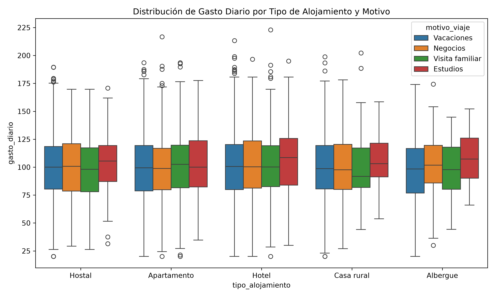

# Evidencia de aprendizaje - Unidad 2
## Visualización y análisis de datos de turismo

**Estudiante:** Oscar Javier Garcia  
**Modalidad:** Trabajo individual  
**Herramienta seleccionada:** Python  
**Dataset:** Datos procesados de turismo y hospedaje

---

## 1. Introducción

La visualización de datos permite transformar registros en información comprensible para identificar patrones, comparar categorías y analizar tendencias. En esta actividad se trabajó con un conjunto de datos simulados de turismo y hospedaje que contiene variables categóricas, numéricas, temporales y geográficas.

El proyecto implementa un flujo reproducible en Python para cargar, validar, analizar y visualizar los datos. Como resultado se generaron un gráfico estadístico sobre el gasto diario y un gráfico interactivo sobre la evolución mensual del gasto.

## 2. Descripción del conjunto de datos

El archivo utilizado es `datos/datos_procesados_turismo.csv`, con 10.000 registros y 15 columnas. Entre las variables principales se encuentran:

- `fecha`: fecha del viaje.
- `pais` y `ciudad`: ubicación geográfica.
- `latitud` y `longitud`: coordenadas geográficas.
- `tipo_alojamiento`: categoría del alojamiento utilizado.
- `duracion_estancia`: número de días de estancia.
- `gasto_diario`: gasto diario del viajero.
- `valoracion`: valoración otorgada al servicio.
- `transporte`: medio de transporte.
- `motivo_viaje`: motivo principal del viaje.

El proceso convierte la columna `fecha` a un tipo temporal, valida la presencia de las columnas requeridas y utiliza el DataFrame para crear agrupaciones y visualizaciones.

## 3. Investigación de herramientas de visualización

### 3.1 Tableau

Tableau es una plataforma especializada en análisis visual y construcción de dashboards. Su interfaz permite conectar fuentes de datos y crear gráficos mediante operaciones de arrastrar y soltar.

**Ventajas:**

- Facilita la creación rápida de paneles interactivos.
- Permite combinar varias fuentes de datos.
- Ofrece filtros, mapas y controles visuales avanzados.

**Limitaciones:**

- Algunas funciones requieren licencia.
- La automatización y personalización profunda pueden requerir conocimientos adicionales.
- No integra de forma directa todo el código de carga y validación del proyecto.

### 3.2 Microsoft Power BI

Power BI es una plataforma de Microsoft para integrar datos, construir modelos, crear medidas y publicar reportes interactivos.

**Ventajas:**

- Tiene buena integración con Excel y otros productos de Microsoft.
- Permite crear indicadores, filtros y dashboards interactivos.
- Es apropiado para reportes empresariales y trabajo colaborativo.

**Limitaciones:**

- La experiencia completa depende del ecosistema Microsoft.
- Algunas funciones de publicación y colaboración requieren licencia.
- El procesamiento reproducible mediante código no es tan central como en Python.

### 3.3 Python

Python es un lenguaje de programación que permite realizar la carga, limpieza, transformación, análisis y visualización de datos mediante bibliotecas especializadas.

En este proyecto se utilizaron las siguientes bibliotecas:

- **pandas:** carga, transformación, agrupación y resumen de los datos.
- **Matplotlib:** soporte para la generación de gráficos.
- **Seaborn:** gráfico estadístico de distribución y comparación.
- **Plotly:** gráfico interactivo de tendencia temporal.
- **Streamlit:** dashboard web para explorar los resultados mediante filtros.

**Ventajas:**

- Es gratuito y está disponible en el entorno virtual del proyecto.
- Permite automatizar todo el pipeline.
- Facilita reproducir los resultados cuando cambia el dataset.
- Permite combinar visualizaciones estáticas, interactivas y aplicaciones web.

**Limitaciones:**

- Requiere conocimientos de programación.
- La construcción inicial de un dashboard requiere más trabajo que una herramienta de arrastrar y soltar.
- La presentación final depende de documentar correctamente el código y los resultados.

## 4. Justificación de la herramienta seleccionada

Se seleccionó **Python** porque el dataset combina variables de diferentes tipos y requiere más que una visualización aislada: es necesario cargar los datos, validar su estructura, convertir fechas, agrupar registros, analizar estadísticas y generar archivos de salida.

Python permite realizar todas esas actividades en un mismo flujo reproducible. También se adapta a los objetivos específicos de la actividad:

| Objetivo | Herramienta utilizada | Justificación |
|---|---|---|
| Comparar el gasto según alojamiento y motivo del viaje | Seaborn y Matplotlib | El diagrama de caja permite comparar distribuciones, dispersión y valores extremos entre categorías. |
| Analizar la evolución mensual del gasto | Plotly | La línea interactiva facilita consultar los valores temporales y observar tendencias. |
| Preparar y resumir el dataset | pandas | Permite leer el CSV, convertir fechas, agrupar información y generar estadísticas. |
| Presentar el análisis con filtros | Streamlit | Permite consultar el dataset y los indicadores desde un dashboard web. |

La herramienta también está disponible para el estudiante mediante un entorno virtual local, lo que facilita demostrar la configuración y ejecución solicitadas.

## 5. Metodología de trabajo

1. Se creó el entorno virtual `.venv` para aislar las dependencias.
2. Se instalaron las bibliotecas definidas en `requirements.txt`.
3. Se cargó el archivo CSV mediante pandas.
4. Se validó la existencia de las columnas principales.
5. Se convirtió `fecha` al tipo de dato temporal.
6. Se generó un gráfico de caja con Seaborn.
7. Se agruparon los datos por mes y se generó una línea interactiva con Plotly.
8. Se exportó un resumen ejecutivo a Excel.
9. Se ejecutaron las pruebas automatizadas del proyecto.
10. Se dejó disponible un dashboard interactivo mediante Streamlit.

El pipeline completo se ejecuta con:

```bash
source .venv/bin/activate
python main.py
```

El dashboard se ejecuta con:

```bash
source .venv/bin/activate
python -m streamlit run app.py
```

## 6. Visualizaciones creadas

### 6.1 Distribución del gasto diario



El gráfico de caja compara el gasto diario para cada tipo de alojamiento y lo segmenta por motivo de viaje. Esta visualización permite identificar diferencias entre categorías, variabilidad de los gastos y posibles valores atípicos.

### 6.2 Tendencia mensual del gasto

La segunda visualización es un gráfico interactivo generado con Plotly:

[Ver tendencia mensual del gasto](output/graficos/vis2_tendencia_mensual.html)

El gráfico agrupa los registros por mes y muestra la evolución del gasto diario acumulado. Su interacción permite consultar los valores de cada fecha y facilita el análisis de cambios a lo largo del tiempo.

## 7. Resultados y análisis

El pipeline procesó 10.000 registros correctamente. La visualización de distribución permite comparar el comportamiento del gasto entre los tipos de alojamiento y los motivos de viaje. La visualización temporal permite observar la evolución mensual y detectar períodos con mayor o menor gasto acumulado.

El informe ejecutivo generado en `output/informes/informe_ejecutivo.xlsx` contiene un resumen por tipo de alojamiento y estadísticas generales del dataset. Además, el dashboard permite filtrar los resultados por rango de fechas, tipo de alojamiento y motivo de viaje.

## 8. Conclusiones

Python fue una elección adecuada para este caso porque permitió integrar la preparación de datos, el análisis y la visualización en un proceso automatizado. Seaborn resultó apropiado para comparar distribuciones categóricas y Plotly para representar una tendencia temporal interactiva.

Tableau y Power BI serían alternativas válidas para construir dashboards con menor cantidad de programación, especialmente en ambientes empresariales. Sin embargo, Python ofrece mayor control sobre la transformación de los datos, la reproducibilidad y la generación automática de resultados.

La ejecución técnica fue validada con una prueba automatizada exitosa y con la ejecución completa del pipeline.

## 9. Guion para el video de máximo 8 minutos

El siguiente guion permite grabar la evidencia solicitada:

| Tiempo aproximado | Contenido |
|---|---|
| 0:00-0:45 | Presentar el objetivo de la actividad y el dataset de turismo. |
| 0:45-1:30 | Mostrar la estructura del proyecto y el archivo `requirements.txt`. |
| 1:30-2:15 | Activar `.venv` y mostrar que Python apunta al entorno virtual. |
| 2:15-3:15 | Explicar brevemente la selección de Python frente a Tableau y Power BI. |
| 3:15-4:30 | Ejecutar `python main.py` y mostrar la carga de 10.000 registros. |
| 4:30-5:30 | Abrir el gráfico de caja y explicar qué compara. |
| 5:30-6:30 | Abrir el HTML de Plotly y explicar la tendencia mensual. |
| 6:30-7:30 | Ejecutar `python -m streamlit run app.py` y mostrar los filtros y KPI. |
| 7:30-8:00 | Presentar conclusiones y mostrar los archivos generados. |

El video debe grabarse y entregarse por separado en formato `.mp4`. La duración final no debe superar los 8 minutos.

## 10. Evidencias del proyecto

- Código principal: `main.py`.
- Dashboard: `app.py`.
- Dataset: `datos/datos_procesados_turismo.csv`.
- Gráfico estático: `output/graficos/vis1_gasto_alojamiento_box.png`.
- Gráfico interactivo: `output/graficos/vis2_tendencia_mensual.html`.
- Informe ejecutivo: `output/informes/informe_ejecutivo.xlsx`.
- Prueba automatizada: `tests/test_pipeline.py`.

## 11. Enlaces al repositorio de GitHub

El código fuente y los archivos de evidencia están disponibles en el siguiente repositorio:

- **Repositorio principal:** https://github.com/nickend12/analisis-datos-turismo
- **Documentación del proyecto:** https://github.com/nickend12/analisis-datos-turismo/blob/main/README.md
- **Informe fuente en Markdown:** https://github.com/nickend12/analisis-datos-turismo/blob/main/informe_actividad_unidad_2.md
- **Código del pipeline:** https://github.com/nickend12/analisis-datos-turismo/blob/main/main.py
- **Dashboard interactivo:** https://github.com/nickend12/analisis-datos-turismo/blob/main/app.py
- **Dataset utilizado:** https://github.com/nickend12/analisis-datos-turismo/blob/main/datos/datos_procesados_turismo.csv
- **Visualización estática:** https://github.com/nickend12/analisis-datos-turismo/blob/main/output/graficos/vis1_gasto_alojamiento_box.png
- **Visualización interactiva:** https://github.com/nickend12/analisis-datos-turismo/blob/main/output/graficos/vis2_tendencia_mensual.html
- **Informe ejecutivo:** https://github.com/nickend12/analisis-datos-turismo/blob/main/output/informes/informe_ejecutivo.xlsx
